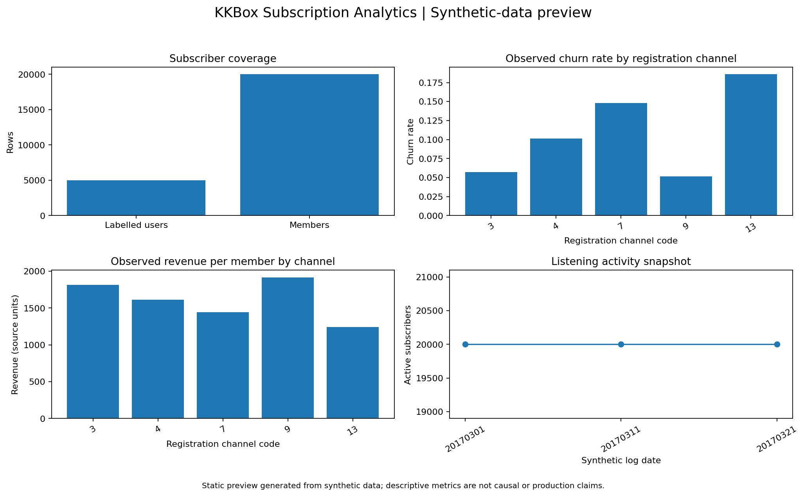

# KKBox Subscription Analytics

An end-to-end subscription analytics portfolio project covering churn prediction, six- and 24-month revenue LTV validation, SQL reporting, and a Streamlit dashboard. **Every committed data file is synthetic and KKBox-schema-shaped; this repository contains no actual KKBox customer or campaign records.**

## What is included

1. **Churn prediction:** subscriber-level feature engineering from member, transaction and listening records; train-only imputation and one-hot encoding inside a scikit-learn Pipeline; chronological signup-date hold-out; Random Forest model selection; ROC-AUC, accuracy, precision, recall, F1, log-loss, confusion matrix, ROC curve and native model feature importance.
2. **Cohort LTV:** observed revenue and a historical channel baseline evaluated on later, fully matured signup cohorts. Validation is explicitly six-month and out-of-time; it does not claim to validate the 24-month decay extrapolation.
3. **SQL analytics:** SQLite cohort retention, churn by plan/auto-renew/city, observed revenue by channel and data-quality checks. Executed result tables are written to results/sql/.
4. **Intervention measurement:** an intention-to-treat evaluator for a properly randomized retention experiment. No treatment-assignment or 30-day outcome data are present, so the repository does not claim an actual offer uplift. A placebo design check is generated from historical labels only to demonstrate the calculation without pretending an offer was delivered.
5. **Dashboard:** Streamlit interactive dashboard plus a reproducible static preview image.

## Data contract

All input CSVs are committed in the repository root and use these canonical names:

| File | Grain | Purpose |
|---|---|---|
| members_v3.csv | Subscriber | City, registration channel and signup date |
| transactions_v2.csv | Transaction | Payment method, plan, amount, auto-renew, transaction and expiry dates |
| user_logs_v2.csv | Subscriber-day | Listening counts, unique tracks and seconds streamed |
| train_v2.csv | Labelled subscriber | Binary is_churn target (1 = churn, 0 = retained) |
| sample_submission_v2.csv | Prediction subscriber | Submission-style subscriber ID list from the original exercise |

The synthetic listening log can be regenerated deterministically:

~~~bash
python scripts/generate_user_logs.py
~~~

See data_dictionary.md for field-level definitions.

## Reproducible setup

Python 3.12 is the CI and recommended Streamlit Community Cloud runtime.

~~~bash
git clone https://github.com/Lifewitdata/kkbox-subscription-analytics.git
cd kkbox-subscription-analytics
python -m venv .venv
# Windows: .venv\Scripts\activate
# macOS/Linux: source .venv/bin/activate
python -m pip install --upgrade pip
pip install -r requirements-dev.txt
~~~

Run the complete reproducible build locally:

~~~bash
python scripts/run_sql_analytics.py
python scripts/train_churn_model.py
python scripts/validate_ltv.py
python scripts/validate_ltv_24m.py
python scripts/analyze_feature_importance.py
python scripts/run_intervention_design_check.py
python scripts/build_dashboard_preview.py
python scripts/smoke_streamlit_server.py
pytest -q
~~~

The GitHub Actions workflow runs the same sequence on pushes and pull requests. It installs development requirements, runs Streamlit's headless AppTest against app.py, and persists generated model, SQL result tables, evaluation outputs and dashboard preview after the tests pass. The workflow also uploads a 30-day build artifact.

## Churn model: leakage-safe evaluation

The canonical model implementation is scripts/train_churn_model.py. The old notebook's target-mean encoding, imputation, scaling, feature selection and PCA-before-split path has been retired from the modelling workflow.

- The labelled population is split chronologically by registration_init_time; the newest signup-date block is held out.
- Median imputation and categorical imputation/one-hot encoding are fitted only inside the sklearn pipeline during training/CV.
- Target-derived mean encodings and PCA are not used.
- The complete preprocessing-plus-classifier pipeline is saved as models/kkbox_churn_pipeline.joblib.
- results/churn/evaluation_metrics.json stores the held-out ROC-AUC, accuracy, precision, recall, F1 and log-loss, along with split details and the confusion matrix.
- results/churn/roc_curve.csv and roc_curve.png contain the ROC data and plot.
- results/churn/feature_importance.csv contains native Random Forest impurity importance. results/churn/grouped_permutation_importance.csv adds held-out grouped permutation importance. Strongly associated numeric, categorical and mixed predictors are grouped using training-only associations, then jointly permuted on the chronological hold-out. These are measures of model reliance, not causal effects.

Metric values describe this synthetic dataset and this particular chronological split, not real KKBox performance.

### Latest verified synthetic-data build

GitHub Actions completed the full build and test suite on the current feature branch. The committed files under models/ and results/ are generated from the current CSV inputs.

**Chronological churn hold-out** — 3,337 training subscribers; 1,644 hold-out subscribers; hold-out signup dates begin 2016-09-01; classification threshold 0.50.

| Metric | Verified hold-out result |
|---|---:|
| ROC-AUC | **0.9980** |
| Accuracy | **99.15%** |
| Precision | **93.02%** |
| Recall | **96.00%** |
| F1 | **94.49%** |
| Log-loss | **0.1249** |

Confusion matrix (rows = actual, columns = predicted):

|  | Predicted retained | Predicted churn |
|---|---:|---:|
| Actual retained | 1,510 | 9 |
| Actual churn | 5 | 120 |

These are verified outputs for the committed synthetic dataset and this one signup-date hold-out. The unusually high scores may reflect relationships built into the synthetic label-generation process. They must not be presented as real KKBox, production or future-population performance.

**Six-month LTV out-of-time hold-out** — training cohorts 2015-01 to 2016-03; later matured hold-out cohorts 2016-04 to 2016-10; 4,846 hold-out subscribers; source data cutoff 2017-03-31.

| Metric | Verified result |
|---|---:|
| MAE | 383.57 source amount units |
| RMSE | 477.37 source amount units |
| WAPE | **36.68%** |
| Mean forecast bias (forecast − actual) | −6.67 source amount units |

The forecast is a historical channel-mean baseline for six-month observed revenue. The separate 24-month decay backtest is reported below.

**Executed SQL outputs:** cohort-retention query 25 rows; churn-by-segment query 27 rows; observed-revenue-by-channel query 5 rows. The six data-quality-check statements returned zero exception rows. Result CSVs and execution_summary.json are committed in results/sql/.

**Retention experiment design check:** randomized placebo assignment over historical labels returned +0.084 percentage points, 95% CI −1.466 to +1.634 pp, p = 0.916. No retention offer was delivered; this is a null-effect design check, not an estimate of intervention uplift.

### Correlation-aware model reliance

On the same 1,644-subscriber chronological churn hold-out, the largest grouped-permutation ROC-AUC drop was **0.1824** for days_since_last_transaction (30 row permutations). This is held-out predictive reliance under the declared grouping procedure, not a causal effect. The analysis uses training-only Spearman, Cramer's V and correlation-ratio associations to group highly associated raw features before jointly shuffling them. Permutation-repeat ranges are not population confidence intervals.

## SQL execution and tests

SQL files live in sql/. Execute them with:

~~~bash
python scripts/run_sql_analytics.py
~~~

The runner loads the root CSV files into a local SQLite database and persists:
- results/sql/01_cohort_retention.csv
- results/sql/02_churn_by_segment.csv
- results/sql/03_ltv_by_channel.csv
- results/sql/04_data_quality_checks.csv
- results/sql/execution_summary.json

The automated tests check data contracts, temporal separation, the committed model and metrics, executed SQL outputs, six- and 24-month chronological LTV outputs, correlated-feature grouping, experiment assignment and the Streamlit AppTest. CI additionally starts the real Streamlit server and checks its HTTP health endpoint.

## Six-month LTV: out-of-time validation

Run scripts/validate_ltv.py. It calculates six-month revenue per subscriber only for signup cohorts with a complete 180-day observation window. Earlier signup-month cohorts form the training period; later matured cohorts are held out chronologically. A channel-level historical mean is estimated from earlier cohorts and scored against later cohorts with MAE, RMSE, WAPE and forecast bias.

This is a transparent baseline validation of **six-month observed revenue LTV**. It is complemented by the 24-month rolling backtest below; the two horizons are reported separately. Contribution-margin sensitivity is shown separately because margin is not provided in the source data.

## 24-month decay scenario: rolling out-of-time validation

Run scripts/validate_ltv_24m.py. Only fully matured signup cohorts with 24 calendar months of subsequent transaction history are eligible. The script runs sequential one-month-ahead folds: it fits the six-month retention decay and active-user ARPU on earlier matured cohorts and forecasts transaction revenue through month 24 for the next matured cohort. It also compares the decay model with a channel historical-mean 24-month revenue baseline fitted only on earlier matured cohorts.

**Latest executed result on this synthetic dataset:**

| Metric | Decay scenario | Prior-cohort mean baseline |
|---|---:|---:|
| Rolling monthly hold-out folds | 2 | 2 |
| Hold-out subscribers across folds | 1,509 | 1,509 |
| 24-month WAPE | **57.63%** | **43.55%** |
| 24-month MAE | 1,307.78 source amount units | 988.37 source amount units |
| 24-month RMSE | 1,633.05 source amount units | 1,157.00 source amount units |

Additional decay-model diagnostics: mean forecast bias **+1,099.89** source amount units per subscriber; mean actual revenue 2,269.28; mean predicted revenue 3,369.16; subscriber-bootstrap 95% WAPE interval 54.07%–61.42%. The decay method's WAPE is 32.3% worse than the historical-mean benchmark.

The decay scenario over-forecasts on average and its two-fold backtest is weak evidence because the available source cutoff (2017-03-31) leaves only three fully matured monthly signup cohorts (2015-01 through 2015-03). The subscriber bootstrap interval measures subscriber-sampling variation only; it does not include decay/model-form, cohort, attribution, margin, or synthetic-data uncertainty. The script also produces a decay-rate sensitivity table. This is a measured backtest, not a claim that the 24-month scenario is reliable or suitable for budgeting.

Files:
- results/ltv/out_of_time_24m_validation.json
- results/ltv/out_of_time_24m_by_fold_channel.csv
- results/ltv/out_of_time_24m_subscriber_predictions.csv
- results/ltv/out_of_time_24m_decay_sensitivity.csv

## Retention experiment evaluation

For a real randomized retention offer, provide a CSV with one row per eligible subscriber and these columns:

| Column | Meaning |
|---|---|
| assigned_treatment | 1 = randomly assigned offer, 0 = control |
| retained_30d | 1 = retained and paying after 30 days, 0 = otherwise |

Then run:

~~~bash
python scripts/evaluate_intervention.py --input path/to/randomized_experiment.csv
~~~

The evaluator reports intention-to-treat retention rates, absolute and relative uplift, a 95% confidence interval and a two-sided p-value; it also reports unsubscribe and contribution-margin guardrails when those columns are supplied. No actual randomized offer or post-offer outcome is present in this repository. results/intervention/placebo_design_check.json is only a null-effect code/design check over historical labels, not intervention evidence. The repository now includes a sample-size planner, stratified deterministic assignment generator, blank experiment template and EXPERIMENT_PROTOCOL.md. These prepare a prospective real test but do not deliver an offer or fabricate results.

### Prepare a prospective retention test

Read EXPERIMENT_PROTOCOL.md before contacting customers. Calculate a required sample size using a business-approved historical baseline and minimum detectable uplift:

~~~bash
python scripts/plan_retention_experiment.py --baseline-retention 0.80 --minimum-detectable-uplift 0.03 --alpha 0.05 --power 0.80 --nonresponse-rate 0.05
~~~

The example baseline and uplift are placeholders, not observed repository statistics. Create an authorised eligibility CSV with one row per subscriber and a pre-defined stratum, then set RETENTION_EXPERIMENT_SEED in the environment and run scripts/prepare_retention_experiment.py. The script assigns within strata; it does not send messages. Join the frozen assignment to delivery, redemption, billing retention and contribution-margin outcomes after the 30-day window, then run the intention-to-treat evaluator.

## Streamlit dashboard

Run locally:

~~~bash
streamlit run app.py
~~~

The dashboard shows synthetic-data coverage, churn by registration channel, observed revenue, listening activity, and model/LTV evaluation outputs when they exist.

### Static dashboard preview

This image is a reproducible static preview generated by scripts/build_dashboard_preview.py; it is not a screenshot of a hosted Streamlit instance.

### Deploy to Streamlit Community Cloud

Runtime setup is included in the repository: root requirements.txt contains only the app runtime packages (Streamlit, pandas and NumPy), while requirements-dev.txt contains modelling, notebook and test packages. The app entry point is at the repository root, all four CSV inputs and generated results are committed, and .streamlit/config.toml sets headless server options. CI runs Streamlit AppTest and starts the actual HTTP server to verify its health endpoint.

[**Open Streamlit Community Cloud**](https://share.streamlit.io/)

1. Sign in with the GitHub account that owns or has access to Lifewitdata/kkbox-subscription-analytics.
2. Select **Create app** and choose **Yup, I have an app**.
3. Set repository to Lifewitdata/kkbox-subscription-analytics, branch to main, and main file path to app.py.
4. In Advanced settings select Python 3.12, then deploy.
5. Once the service finishes deploying, copy the assigned streamlit.app URL into this README under the live URL heading.

[Official deployment instructions](https://docs.streamlit.io/deploy/streamlit-community-cloud/deploy-your-app/deploy) explain the repository, branch, entrypoint and Python selection.

**Hosting status:** this repo is prepared and CI-tested, but a public app URL has not yet been issued. Deployment requires the repository owner's Streamlit Community Cloud sign-in and deploy action. I cannot create that account-level deployment or claim a URL before Streamlit issues it. The static screenshot remains only a preview.

### Troubleshooting “Oh no. Error running your app.”

This generic Community Cloud page does not identify the underlying error by itself. The app entry point now displays runtime versions, source-file presence/size, and the actual CSV-loading exception whenever Python reaches the Streamlit script.

1. Open the deployed app and click **Manage app** in the lower-right corner.
2. Open **Cloud logs** and copy the first Python traceback or dependency-install error. Streamlit documents Cloud logs as the primary troubleshooting location.
3. In the app workspace, open the app menu → **Settings** and verify:
   - Repository: Lifewitdata/kkbox-subscription-analytics
   - Branch: main
   - Main file: app.py
   - Python: 3.12
4. After changing requirements or app code, let Community Cloud finish redeploying. Then use **Reboot** from the app menu and clear cache if the old process is still active.
5. If the Cloud logs contain no Python exception and only the generic “Oh no” state, check the resource-limit guidance. Streamlit says this can indicate that the app exceeded its available CPU or memory.

The dashboard now reads only the columns it uses (rather than loading every raw column), validates all four required CSVs before rendering, and shows any data-loading/rendering exception on the page. The production runtime uses only Streamlit, pandas and NumPy; model training dependencies remain in requirements-dev.txt and are not installed by Community Cloud.

**Important:** a passing GitHub Actions test proves the code starts in the CI environment; it does not expose private Community Cloud logs or prove that the correct repository/branch/entrypoint is selected in your Streamlit workspace. If the app still fails after redeployment, the first traceback from Manage app → Cloud logs is required to identify the exact remaining cause.

## Model card, stakeholder use and limits

- MODEL_CARD.md documents intended use, feature timing, validation and limitations.
- STAKEHOLDER_BRIEF.md explains which decisions the synthetic data cannot support.
- data_dictionary.md defines the dataset and metrics.

Do not use the synthetic model for real customer targeting, choose a real acquisition channel, set a real CAC budget or claim a retention intervention works. Production use requires authorised first-party data, a point-in-time feature contract, privacy/fairness review, calibration and monitoring, mature cohort validation, contribution margin and spend attribution, and a properly randomized retention experiment.

## Repository structure

~~~text
kkbox-subscription-analytics/
├── .github/workflows/ci.yml
├── app.py
├── requirements.txt                 # lightweight Streamlit runtime
├── requirements-dev.txt             # modelling, notebook and test tools
├── EXPERIMENT_PROTOCOL.md
├── experiment_template.csv
├── data_dictionary.md
├── kkbox_churn_modeling.ipynb
├── kkbox_ltv_cac_analysis.ipynb
├── members_v3.csv
├── transactions_v2.csv
├── user_logs_v2.csv
├── train_v2.csv
├── sample_submission_v2.csv
├── scripts/
│   ├── build_dashboard_preview.py
│   ├── evaluate_intervention.py
│   ├── analyze_feature_importance.py
│   ├── plan_retention_experiment.py
│   ├── prepare_retention_experiment.py
│   ├── smoke_streamlit_server.py
│   ├── generate_user_logs.py
│   ├── load_sqlite.py
│   ├── run_intervention_design_check.py
│   ├── run_sql_analytics.py
│   ├── train_churn_model.py
│   └── validate_ltv.py
├── sql/
│   ├── 01_cohort_retention.sql
│   ├── 02_churn_by_segment.sql
│   ├── 03_ltv_by_channel.sql
│   └── 04_data_quality_checks.sql
├── tests/
│   └── test_data_contracts.py
├── models/                         # generated fitted pipeline
├── results/
│   ├── churn/                      # metrics, ROC, confusion matrix, importance
│   │   └── grouped_permutation_importance.*
│   ├── intervention/               # placebo design check
│   ├── ltv/                        # 6m and 24m chronological hold-out results
│   └── sql/                        # executed query result tables
└── dashboard_screenshots/
    └── overview.png
~~~
